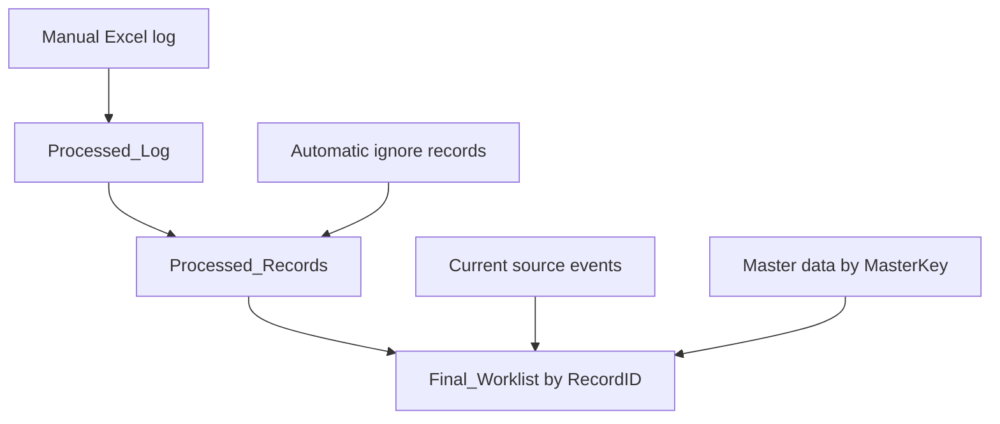

# A Dummies Guide to Understanding the CPAR Power Queries

## Start here: what is a query?

A query is a saved set of instructions that reads data and prepares a result. **Refresh** runs those instructions again. **M** is the language used to write them.

### Read the processing flow in plain language

1. Staff or VBA record an action in the Excel log table.
2. Processed_Log cleans that log.
3. Processed_Records combines manual actions with eligible automatic exclusions.
4. Final_Worklist matches the event’s RecordID and removes completed/ignored events.

The patient/panel key (MasterKey) is separate from the event key (RecordID). Completing one event must not complete every event for that patient.

### Before you paste code

- A **complete query** can replace the named query’s full Advanced Editor contents.
- A **patch fragment** describes a small edit; it cannot run by itself.
- Keep Processed_Log connection-only. Do not load it over its own input table.

## Technical reference

## Scope

These notes explain **three supplied files**, not a full reconstruction of every query in your workbook. `Processed_Log.m` is executable M code. The other two files contain **editing fragments**, not complete runnable queries. Do not paste the patch files as replacements in Advanced Editor.

## Data flow

**RecordID** identifies an individual event and is used to apply DONE/IGNORE status. **MasterKey** identifies a patient/panel and is used for master record lookups. Multiple events can share one MasterKey.

## 1. Processed_Log.m (complete query)

**Source:** Excel table named `tblProcessedLog`. **Required columns:** `RecordID`, `Status`. **Columns retained:** `RecordID`, `MasterKey`, `PanelID`, `Doctor`, `PatientID`, `Source`, `EventDate`, `DateProcessed`, `Status`, `Notes`, `DateStarted`, `ActionTaken`.

| Step | Operation | Reason |
|---|---|---|
| `Source` | `Excel.CurrentWorkbook(){[Name="tblProcessedLog"]}[Content]` | Reads the manual action log maintained in Excel |
| `Required` | Sets `RecordID`, `Status` as mandatory | Prevents silently processing an unusable log |
| `Missing` | Finds required names absent from the Excel table | Supplies a clear error list |
| `Validated` | Errors if either required column is absent | Makes setup failures visible |
| `Fields` | Defines output column names | Standardizes the downstream schema |
| `Selected` | Retains those names, adding nulls for absent optional columns | Allows older tables with fewer fields to continue |
| `CleanText` | Converts and trims identifier and status text | Reduces failed joins from whitespace |
| `CleanStatus` | Uppercases the `Status` column | Standardizes `done` → `DONE` |
| `Dates` | Converts `EventDate` to date and two process fields to datetime | Gives predictable types; invalid values become null |
| `ValidRows` | Excludes blank or null RecordID rows | Prevents matching empty event keys |

**Important limitations:** This query does not deduplicate `RecordID`; it does not validate valid statuses; it does not prove that a `MasterKey` belongs to the provided `PatientID`; it does not create processing timestamps. `DateProcessed` must be written when the user takes the action (e.g., VBA). It also does not guarantee a correctly formatted RecordID—the upstream and downstream formats still need to match.

**Refresh safety:** Set this query to *Connection Only*, or load it to a separate destination. Never load its output into `tblProcessedLog`, its own input table.

## 2. PowerQuery_Processed_Records_patch.m (patch only)

**Purpose:** Preserve manually recorded metadata when merging with existing automatic IGNORE output.

| Fragment | How to apply | Why |
|---|---|---|
| `Manual0` or `Manual` | Confirm it reads `Processed_Log` | Makes new fields from the log available |
| `OutputColumns` | Add the listed 12 fields | Preserves new `MasterKey`, `PanelID`, `Doctor`, `PatientID`, `Source`, `EventDate`, `DateProcessed` alongside existing fields |
| `Manual = Table.SelectColumns(...)` | Align manual rows to output schema; uses `MissingField.UseNull` | Avoids errors for missing optional columns |
| Automatic output | Align it to the same output fields before combining | Makes table append structurally consistent |
| `RecordID` matching | Keep existing RecordID precedence logic | Prevents grouping unrelated patient events |

**Do not erase:** `AutoRules`, `Ignore_Rules`, suppression logic, overrides, or the full existing query structure. The provided patch does **not** contain their definitions. Also, the step label `Manual` might not match your current M query; adapt it to your actual step names.

**Special consideration:** A manually marked event should override an automatic result only as your existing logic defines. If the same RecordID appears in multiple status rows, review precedence explicitly; this patch does not determine which row wins.

## 3. PowerQuery_Final_Worklist_patch.m (patch only)

**Purpose:** Verify that worklist status is associated with events, not patients.

| Step/area | Required behavior | Why |
|---|---|---|
| `ProcessedSource` | Select only `RecordID` and `Status` for status matching | Small status lookup and no accidental metadata clashes |
| `CleanProcessedStatus` | Trim RecordID, normalize Status | Avoids false non-matches from whitespace/case |
| `ProcessedByRecord` | Group statuses by RecordID | One status result per event |
| `CleanCurrentRecordID` | Trim current event keys before joining | Ensures consistent join values |
| `MergeProcessed` | Join on `{"RecordID"}` on both sides | Processes the individual event only |
| `MergeMaster` | Join on `{"MasterKey"}` to Master_Patient_List | Looks up patient-level date information; NOT processing status |
| `FilterOpen` | Remove `DONE` / `IGNORE` statuses | Leaves open events in the active worklist |
| `RemoveCPARYes` | Keep the existing CPAR: Yes exclusion | Preserves current worklist business rule |

Your earlier full Final_Worklist query already used the correct `RecordID` merge. The patch is a guardrail against accidentally changing it to `MasterKey` while extending the log.

## Installation (step by step)

1. Save a backup of the `.xlsm` workbook.
2. Confirm the **Excel table** `tblProcessedLog` includes the columns populated by your VBA buttons.
3. In Excel, choose **Data → Queries & Connections**.
4. Right-click `Processed_Log` → **Edit** → **Home → Advanced Editor**.
5. Replace its M script with the complete `Processed_Log_documented.m` code. Click **Done**.
6. Open `Processed_Records` Advanced Editor. **Do not replace the entire script**; apply only the matching fragments from `PowerQuery_Processed_Records_patch_documented.m`.
7. Open `Final_Worklist`. Verify the `RecordID` status join and preserve its separate `MasterKey` master-data join using `PowerQuery_Final_Worklist_patch_documented.m`.
8. Test with one record, then with two records sharing a MasterKey but having different RecordIDs. Check `tblProcessedLog` before and after refresh.

## Test cases

| Test | Expected behavior |
|---|---|
| Mark event A DONE | `tblProcessedLog` contains A, with metadata/date; A disappears after refresh |
| Event B shares A's MasterKey but has different RecordID | B remains open |
| Mark B IGNORE | B disappears after refresh, independent of A |
| Open `Processed_Log` preview | Shows all named columns; optional absent fields display null |
| Blank RecordID in log | Excluded from `Processed_Log` |
| Undo a newly created action before refresh | Log entry removed; event visible after refresh |
| Duplicate RecordID entries in log | `Processed_Log` retains them; downstream precedence must resolve them |

## Known unknowns

The current complete `Processed_Records` M code was not included with these files, so its automatic rule handling and precise duplicate precedence **cannot be fully verified from these patches alone**. The final worklist code recovered from earlier material is an older snapshot; compare it with the query currently in Excel before editing.
