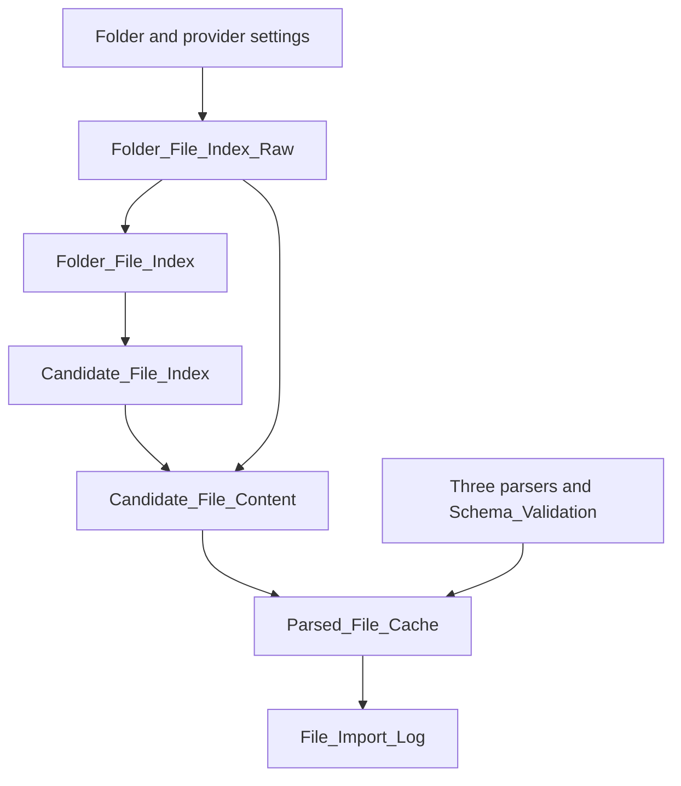
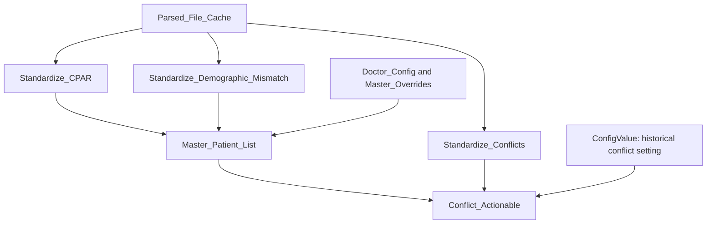
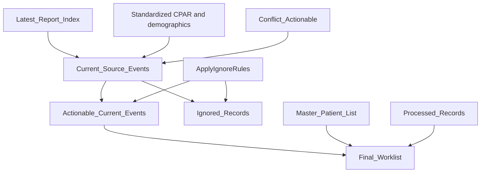
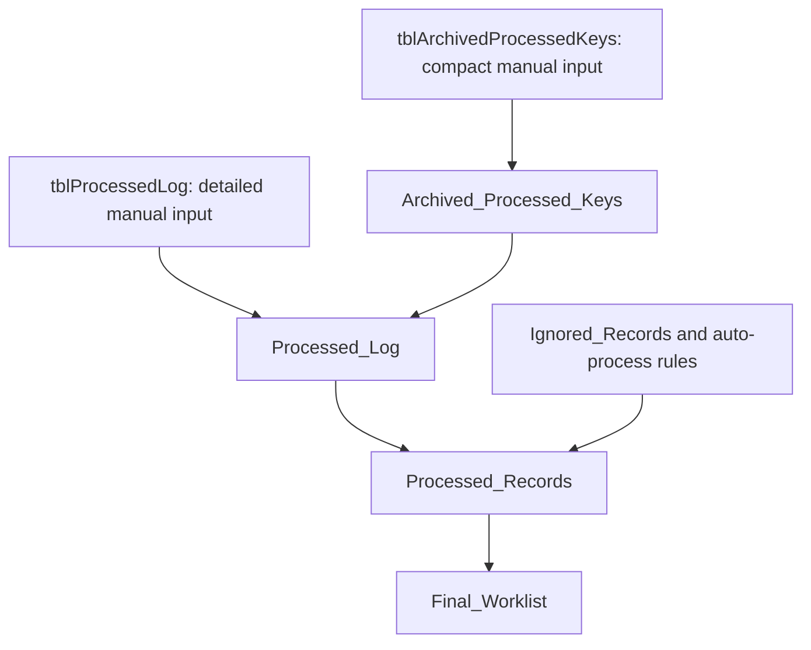

# A Dummies Guide to How the CPAR Queries Connect

The workbook turns three kinds of reports into one worklist, then uses your saved decisions to keep completed events out of that worklist.

This guide describes the repository queries, including the proposed archive addition in [PR #4](https://github.com/alby1976/CPAR/pull/4). The archive changes are maintained separately from this guide. Your screenshot shows the earlier main query graph; the two archive queries must be installed separately. A screenshot cannot prove that every formula in your local workbook matches the repository.

## How to read the arrows

An arrow means **the next query reads the previous query's result**. It does not mean Power Query writes back to the previous table. Excel resolves dependencies during evaluation; the diagrams are not a manual refresh-click sequence.

**Not loaded** in Query Dependencies usually means the query does not output a worksheet table or model table. Other queries can still evaluate it. A function query, such as Parse_CPAR_File, is called with arguments by another query.

## 1. Find, choose and parse report files

Folder_File_Index_Raw reads tblFolderConfig and the filesystem. Folder_File_Index joins those files to Doctor_Config. Candidate_File_Index selects candidates before expensive parsing. Candidate_File_Content attaches binary contents from the raw index. Parsed_File_Cache calls the matching parser and keeps a parsed table plus diagnostics for each candidate.

The name **cache** does not guarantee that Excel parses every file only once across Refresh All. Separate query evaluations can still repeat upstream work.

Folder_CPAR, Folder_Conflicts, Folder_Demographic_Mismatch, Folder_Metrics and File_Inventory are side views of the index. The current parsing chain reads Candidate_File_Content; it does not pass through those separate folder views. Metrics remains an inventory helper, outside this project's three-report reconciliation scope.

## 2. Standardize reports and build the master list

The three Standardize queries turn different report formats into consistent fields. Master_Patient_List adds the patient/panel context needed for reconciliation. Conflict_Actionable compares conflict dates against the effective master entry date and creates the conflict event RecordID. Its historical exclusion is controlled by configuration.

Metadata_Mismatches branches from the demographic and conflict standardized outputs for auditing. It is not the final worklist.

## 3. Decide which events need attention

Latest_Report_Index ranks successfully imported files separately for each PanelID and SourceType. Current_Source_Events keeps events from the latest files. ApplyIgnoreRules splits those current events into actionable and ignored branches.

Processed_Records combines saved decisions with ignore rules that are explicitly allowed to auto-process. Final_Worklist joins that processing information and removes terminal decisions and CPAR: Yes entries. Ignored_Records is a query result, not the permanent manual ledger.

## 4. Track changes between reports

Previous_Report_Index selects LatestRank = 2, the second-ranked valid file in the current inventory. Previous_Source_Events builds comparable events from those files. State_Changes compares those events with Actionable_Current_Events.

This comparison needs the older report files to remain loaded. Removing the prior CSV can change or remove the previous comparison baseline. State_Changes is a side output; Final_Worklist does not read State_Changes in the current source.

## 5. Save processing decisions and preserve archived decisions

Mark Done/Ignore VBA writes decisions to tblProcessedLog. Power Query reads that table on refresh. The archive VBA moves eligible detail to an external workbook and retains compact keys in tblArchivedProcessedKeys. Processed_Log reads both sources, so reloading an old CSV does not erase the old processing decision.

**Never load Processed_Log over tblProcessedLog or Archived_Processed_Keys over tblArchivedProcessedKeys.** These are persistent input tables. Query output belongs elsewhere or remains connection-only.

| Identifier | Meaning | Used for |
|---|---|---|
| RecordID | One report event | Matching DONE/IGNORE and archived decisions |
| MasterKey | Patient/panel grouping | Master-list joins, grouping and audit context |

Processing one RecordID must not automatically process every other event with the same MasterKey. State_Changes uses its own comparison keys; it is not the processing ledger.

## 6. Check archive eligibility before removing detail

Archive_Loaded_RecordIDs reads **all three standardized report histories**, not only latest/actionable events. For conflicts it generates the same MasterKey + CONFLICT + event-date RecordID form used by Conflict_Actionable, without the optional historical exclusion.

It also reads File_Errors, Unmapped_Doctor_Files, Missing_Expected_Reports and File_Import_Log. Those checks must succeed before it returns a fresh READY marker plus IDs. A failed or empty snapshot blocks the archive macro.

The archive button refreshes this dedicated output synchronously, keeps still-loaded IDs, and only selects absent completed actions with DateProcessed older than **four months**. It saves and verifies external detail, saves compact keys, then deletes selected active detail. Archive_Folder in tblFolderConfig supplies the destination; the raw file index excludes the configured archive directory from doctor-folder discovery.

**Final_Worklist is unsuitable for archive eligibility:** completed records are deliberately removed from that output. Absence there does not mean their CSV is no longer loaded.

## 7. Configuration tables and outputs

| Persistent Excel input table | Query that reads it | Purpose |
|---|---|---|
| tblFolderConfig | ConfigValue; Folder_File_Index_Raw | Report root, archive directory and settings |
| tblDoctorConfig | Doctor_Config | Active panel/provider folder mapping |
| tblMasterInput | Master_Overrides | Manual master information |
| tblIgnoreRules | Ignore_Rules | Ignore conditions and permitted automatic actions |
| tblReportExpectations | Report_Expectations | Required report expectations |
| tblReportExpectationExceptions | Report_Expectation_Exceptions | Explicit exceptions |
| tblProcessedLog | Processed_Log | Detailed saved processing decisions |
| tblArchivedProcessedKeys | Archived_Processed_Keys | Compact saved archived decisions |

| Output or artifact | Who writes it? | Important distinction |
|---|---|---|
| Worklist_Output / tblFinalWorklist | Final_Worklist query; VBA can show a temporary status | Refresh rebuilds the worklist |
| tblArchiveLoadedRecordIDs | Archive_Loaded_RecordIDs query | Refresh output with READY marker, not a manual ledger |
| History .xlsx and backup .xlsm | ArchiveOldHistory VBA | External files, not query inputs |
| tblProcessedLog / tblArchivedProcessedKeys | Action/archive VBA and deliberate manual maintenance | Persistent input, not a query load destination |

## 8. Every query's direct dependencies

The table below lists immediate upstream queries/functions found in executable M, excluding comments and string values. Follow an upstream row to trace indirect dependencies. An empty dependency list can still mean an external table, folder or supplied function argument is read.

| Query/function | Direct upstream queries/functions | What it does |
|---|---|---|
| [Actionable_Current_Events](../power-query/Actionable_Current_Events.m) | `ApplyIgnoreRules`, `Current_Source_Events` | Keep current events with no matching ignore rule. |
| [ApplyIgnoreRules](../power-query/ApplyIgnoreRules.m) | `Ignore_Rules` | Function: evaluate a source event against Ignore_Rules. |
| [Archive_Loaded_RecordIDs](https://github.com/alby1976/CPAR/blob/feat/archive-processed-history/power-query/Archive_Loaded_RecordIDs.m) | `File_Errors`, `File_Import_Log`, `Missing_Expected_Reports`, `Standardize_CPAR`, `Standardize_Conflicts`, `Standardize_Demographic_Mismatch`, `Unmapped_Doctor_Files` | Build all loaded event IDs with a fresh READY marker; block on import, mapping or missing-report problems. |
| [Archived_Processed_Keys](https://github.com/alby1976/CPAR/blob/feat/archive-processed-history/power-query/Archived_Processed_Keys.m) | None; see external inputs or function arguments | Read permanent compact archived RecordID/Status/DateProcessed input. |
| [Candidate_File_Content](../power-query/Candidate_File_Content.m) | `Candidate_File_Index`, `Folder_File_Index_Raw` | Attach the original binary Content to candidate files by folder path and filename. |
| [Candidate_File_Index](../power-query/Candidate_File_Index.m) | `Folder_File_Index` | Select import candidates and classify file metadata/duplicates before parsing. |
| [ConfigValue](../power-query/ConfigValue.m) | None; see external inputs or function arguments | Function: read a setting from tblFolderConfig. |
| [Conflict_Actionable](../power-query/Conflict_Actionable.m) | `ConfigValue`, `Master_Patient_List`, `Standardize_Conflicts` | Compare conflicts against master entry dates, apply the optional historical filter and create conflict RecordIDs. |
| [Current_Source_Events](../power-query/Current_Source_Events.m) | `Conflict_Actionable`, `Latest_Report_Index`, `Standardize_CPAR`, `Standardize_Demographic_Mismatch` | Select events from latest reports; use conflict actionability and valid demographic metadata. |
| [DoctorRecordFromPath](../power-query/DoctorRecordFromPath.m) | `Doctor_Config` | Function: resolve a folder path against Doctor_Config; available helper, not called by the current import chain. |
| [Doctor_Config](../power-query/Doctor_Config.m) | None; see external inputs or function arguments | Read and validate active provider/panel folder mappings. |
| [File_Errors](../power-query/File_Errors.m) | `File_Import_Log` | Audit failed imports, schemas or provider metadata. |
| [File_Import_Log](../power-query/File_Import_Log.m) | `Parsed_File_Cache` | Expose import diagnostics without nested patient tables. |
| [File_Inventory](../power-query/File_Inventory.m) | `Folder_File_Index` | File inventory view for inspection. |
| [Final_Worklist](../power-query/Final_Worklist.m) | `Actionable_Current_Events`, `Master_Patient_List`, `Processed_Records` | Join actionable events to master and processed information; remove terminal decisions and CPAR: Yes. |
| [Folder_CPAR](../power-query/Folder_CPAR.m) | `Folder_File_Index` | CPAR-only view of the mapped file index. |
| [Folder_Conflicts](../power-query/Folder_Conflicts.m) | `Folder_File_Index` | Conflict-only view of the mapped file index. |
| [Folder_Demographic_Mismatch](../power-query/Folder_Demographic_Mismatch.m) | `Folder_File_Index` | Demographic-only view of the mapped file index. |
| [Folder_File_Index](../power-query/Folder_File_Index.m) | `Doctor_Config`, `Folder_File_Index_Raw` | Attach mapped provider/panel information to discovered files. |
| [Folder_File_Index_Raw](https://github.com/alby1976/CPAR/blob/feat/archive-processed-history/power-query/Folder_File_Index_Raw.m) | None; see external inputs or function arguments | Read the configured report root and supported report subfolders; exclude the configured archive directory. |
| [Folder_Metrics](../power-query/Folder_Metrics.m) | `Folder_File_Index` | Metrics file-index view retained in the source; not part of the three-report reconciliation worklist. |
| [Ignore_Rules](../power-query/Ignore_Rules.m) | None; see external inputs or function arguments | Read and normalize configurable ignore rules. |
| [Ignored_Records](../power-query/Ignored_Records.m) | `ApplyIgnoreRules`, `Current_Source_Events` | Return current events that match ignore rules. |
| [Latest_Report_Index](../power-query/Latest_Report_Index.m) | `File_Import_Log` | Rank valid files per PanelID and SourceType; rank 1 is LATEST, other ranks are HISTORICAL. |
| [Master_Overrides](../power-query/Master_Overrides.m) | None; see external inputs or function arguments | Read manual master-list input/overrides. |
| [Master_Patient_List](../power-query/Master_Patient_List.m) | `Doctor_Config`, `Master_Overrides`, `Standardize_CPAR`, `Standardize_Demographic_Mismatch` | Build patient/panel master information from normalized reports, mappings and overrides. |
| [Metadata_Mismatches](../power-query/Metadata_Mismatches.m) | `Standardize_Conflicts`, `Standardize_Demographic_Mismatch` | Audit report/provider metadata mismatches from conflicts and demographic reports. |
| [Missing_Expected_Reports](../power-query/Missing_Expected_Reports.m) | `Doctor_Config`, `Latest_Report_Index`, `Report_Expectation_Exceptions`, `Report_Expectations` | Compare expected reports with valid latest reports and provider configuration. |
| [Parse_CPAR_File](../power-query/Parse_CPAR_File.m) | None; see external inputs or function arguments | Function: parse one panel submission results file. |
| [Parse_Conflict_File](../power-query/Parse_Conflict_File.m) | None; see external inputs or function arguments | Function: parse one conflict report file. |
| [Parse_Demographic_Mismatch_File](../power-query/Parse_Demographic_Mismatch_File.m) | None; see external inputs or function arguments | Function: parse one demographic mismatch report file. |
| [Parsed_File_Cache](../power-query/Parsed_File_Cache.m) | `Candidate_File_Content`, `Parse_CPAR_File`, `Parse_Conflict_File`, `Parse_Demographic_Mismatch_File`, `Schema_Validation` | Call the appropriate parser and schema checks; retain parsed tables and import diagnostics. |
| [Previous_Report_Index](../power-query/Previous_Report_Index.m) | `Latest_Report_Index` | Select rank 2 from the ranked file index; this is not a stored snapshot of the previous refresh. |
| [Previous_Source_Events](../power-query/Previous_Source_Events.m) | `ApplyIgnoreRules`, `Conflict_Actionable`, `Previous_Report_Index`, `Standardize_CPAR`, `Standardize_Demographic_Mismatch` | Build comparable events from second-ranked reports and apply ignore rules. |
| [Processed_Log](https://github.com/alby1976/CPAR/blob/feat/archive-processed-history/power-query/Processed_Log.m) | `Archived_Processed_Keys` | Read detailed manual history plus archived compact keys; normalize identifiers, status and dates. |
| [Processed_Records](../power-query/Processed_Records.m) | `Ignore_Rules`, `Ignored_Records`, `Processed_Log` | Combine manual/archived processing decisions with permitted automatic ignore decisions. |
| [Report_Expectation_Exceptions](../power-query/Report_Expectation_Exceptions.m) | None; see external inputs or function arguments | Read exceptions to report expectations. |
| [Report_Expectations](../power-query/Report_Expectations.m) | None; see external inputs or function arguments | Read expected report settings. |
| [Schema_Validation](../power-query/Schema_Validation.m) | None; see external inputs or function arguments | Function: check expected source columns. |
| [Standardize_CPAR](../power-query/Standardize_CPAR.m) | `Parsed_File_Cache` | Normalize parsed submission results and generate CPAR event identifiers. |
| [Standardize_Conflicts](../power-query/Standardize_Conflicts.m) | `Parsed_File_Cache` | Normalize parsed conflicts and provider/patient metadata. |
| [Standardize_Demographic_Mismatch](../power-query/Standardize_Demographic_Mismatch.m) | `Parsed_File_Cache` | Normalize parsed panel-versus-registry fields and generate demographic event identifiers. |
| [State_Changes](../power-query/State_Changes.m) | `Actionable_Current_Events`, `Previous_Source_Events` | Compare current actionable and previous events using state keys. |
| [Unmapped_Doctor_Files](../power-query/Unmapped_Doctor_Files.m) | `Folder_File_Index` | Audit files whose folder/provider mapping is not OK. |

## 9. Where to look when something goes wrong

| Symptom | Start checking here |
|---|---|
| No reports found | tblFolderConfig → Folder_File_Index_Raw → Folder_File_Index |
| A report is rejected | File_Errors, Unmapped_Doctor_Files and Metadata_Mismatches |
| A patient field disappears | Parser → relevant Standardize query → Current_Source_Events → Final_Worklist selected columns |
| An older report appears as current | File_Import_Log dates → Latest_Report_Index ranks |
| A conflict disappears | Standardize_Conflicts → Conflict_Actionable historical setting → ignore rules → processed decisions |
| DONE returns after refresh | Actual VBA button assignment → tblProcessedLog → Processed_Log → Processed_Records → Final_Worklist RecordID match |
| A completed event returns after archiving | tblArchivedProcessedKeys → Archived_Processed_Keys → Processed_Log |
| Archiving stops | Snapshot refresh, File_Errors, Unmapped_Doctor_Files, Missing_Expected_Reports and Archive_Folder access |
| Refresh is slow | Candidate count, Parsed_File_Cache evaluation, master joins and repeated upstream evaluations |

## Related guides

- [Workbook user manual](AHS_CPAR_User_Manual.md)
- [Power Query technical guide](CPAR_PowerQuery_Documentation.md)
- [Archiving old history](https://github.com/alby1976/CPAR/blob/feat/archive-processed-history/docs/Archiving_Old_History.md)
- [Automatic worklist columns](Worklist_Column_Visibility.md)
- [Automatic filter reapplication](Automatic_Filter_Reapply.md)

Validation: all 44 top-level query files were inventoried, direct references were checked for cycles, and document links were checked. The diagrams summarize selected connections; the direct-dependency table provides the complete query-reference inventory. This is source inspection, not evidence of a successful live Excel refresh.
